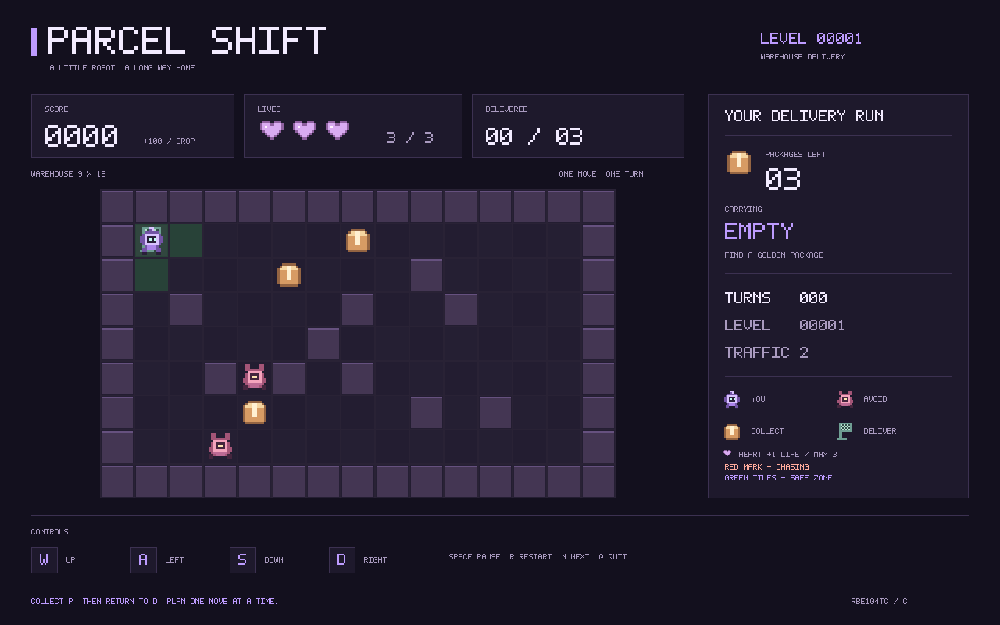

# Parcel Shift

RBE104TC 仓库配送游戏，提供终端版和 SDL2 像素窗口版。机器人拾取包裹并送回配送点，同时避开叉车。

终端版用于满足课程提交要求，SDL 版继续保留。后续开发要求两端保持相同的游戏功能；输入方式和显示形式可以不同。两端共用 `game.c` 的状态、规则、回合处理、暂停、重开和胜负判断；终端与 SDL 分别负责输入和显示。



## 编译与运行

以下命令在 Windows PowerShell 中执行，需要 GCC 在 `PATH` 中。

```powershell
cd "D:\Users\Admin\Desktop\Y2S1\RBE104 course work\game"
.\scripts\build_basic.bat
.\build\windows\terminal.exe
```

默认构建与 `basic` 参数相同：编译终端版、预览和测试程序，运行测试，并生成 `build/windows/preview.ppm`、`delivered.ppm`。脚本结束时按任意键返回。

终端版先输入叉车数（1–4），再输入关卡号（1–99999，也是唯一 seed，直接回车默认 1）。每次输入一个命令后按回车：W/A/S/D 移动，P 暂停/继续，R 重开当前关卡，Q 退出；大小写均可。胜负后可用 R 重开或 Q 退出，获胜后 N 进入下一关。

窗口版：

```powershell
.\scripts\build_basic.bat gui
.\build\windows\parcel_shift.exe 1 2
```

参数依次为关卡号和叉车数，省略时使用 1 和 2。关闭游戏后再重新编译。

地图格子固定为 44×44，角色和地图道具图标固定为 36×36 逻辑像素。画布从 1280×800 随地图扩展，最大为 1808×1152；切换地图尺寸时自动调整窗口。超过屏幕工作区时等比缩小以显示完整界面，手动缩放窗口也保持宽高比。

| 窗口操作 | 按键 |
| --- | --- |
| 移动一格 | WASD 或方向键，长按不连发 |
| 暂停 / 继续 | 空格 |
| 重开当前关卡 | R |
| 获胜后进入下一关 | N |
| 退出 | Q、Esc 或关闭窗口 |

GUI 构建需要与 GCC 架构匹配的 MinGW SDL2 开发库。脚本读取 `SDL2_ROOT`，未设置时使用本机路径：

```text
D:\Coding\env\SDL2\SDL2-2.32.10\x86_64-w64-mingw32
```

换电脑后，设置为实际安装目录，例如：

```powershell
$env:SDL2_ROOT = 'C:\Libraries\SDL2\x86_64-w64-mingw32'
.\scripts\build_basic.bat gui
```

该目录应包含 `include/SDL2/SDL.h`、`lib/` 和 `bin/SDL2.dll`。脚本将 DLL 复制到 EXE 旁，并在上级目录存在 `LICENSE.txt` 时复制为 `SDL2-LICENSE.txt`。分发窗口版时保留 DLL 和许可证。窗口版不依赖 SDL_image、SDL_ttf 或外部字体、图片。

## 游戏规则

- 有效移动后，每辆叉车行动一次；撞墙和无效命令不消耗回合。
- 每次携带一个包裹，送回配送点得 100 分，全部送达后获胜。
- 包裹数随地图增加：9×15 为 3 个；9×19、11×23 为 4 个；13×27、17×31 为 5 个。
- 初始三条命，碰撞每回合最多扣一命。机器人和叉车回到各自起点，携带包裹保留。
- 每局有 50% 概率在第 5–20 个有效移动回合结束后掉落一个回血道具，最多一个，不补刷。落点为空地，避开机器人、叉车、包裹和配送点；无空地时延后尝试。终端显示 `+`，SDL 显示爱心。无碰撞时走上去回复一命，上限三命，满血时保留。重开复现掉落设置。
- 出生点和配送点的曼哈顿距离一格以内为安全区，叉车不能进入；SDL 用绿色地格标出。安全区不包含包裹周围。
- 叉车巡逻时直行，受阻才转向；可走路径距离不超过四格时发现玩家，最多追踪六个有效移动回合，再冷却四回合。玩家进入安全区立即停止追踪；无合法方向时等待。
- SDL 追踪中的叉车显示红色底框和感叹号；终端以 `!` 代替 `F`。
- SDL 碰撞后在屏幕中央显示扣命和重生提示，停留 1.5 秒，期间忽略移动、暂停和换关输入，仍可退出或重开。终端显示碰撞提示框，等待下一条输入。
- 同版本下，相同关卡号、叉车数量和操作序列可复现；地图和叉车使用固定 32 位随机算法。
- 地图先通过连通性检查，再分别验证 1–4 辆叉车的获胜路线。超过生成或搜索上限会提示失败，不放行未验证地图。

关卡 1–999 为 9×15，1000–9999 为 9×19，10000–29999 为 11×23，30000–59999 为 13×27，60000–99999 为 17×31。内部重试保持尺寸和关卡号不变。生成、重试和检查约定见 [关卡实现](docs/LEVELS.md)。

## 文件入口

| 路径 | 用途 |
| --- | --- |
| `src/game.c`、`src/game.h` | 终端、窗口、预览和测试共用的地图、状态、规则与游戏操作 |
| `src/level.c`、`src/level.h` | 确定性地图生成、尺寸分段与 BFS 合法检查 |
| `src/solver.c` | 调用共享核心搜索获胜路线 |
| `src/scene.c`、`src/scene.h` | 随地图扩展的像素缓冲区、固定尺寸图标、字体和 HUD |
| `src/window.c` | SDL2 窗口与键盘事件入口 |
| `src/terminal.c` | 终端输入和文本显示入口，调用共享游戏核心 |
| `tests/test_terminal.py` | 终端命令、暂停、重开、胜负后操作和输入校验集成测试 |
| `tests/test_game.c` | 规则断言、绘制调用与 PPM 写入检查 |
| `tools/preview.c` | 不依赖 SDL 的初始画面导出入口 |
| `scripts/build_basic.bat` | Windows 构建入口 |
| [维护与交接](docs/TEAM_HANDOFF.md) | 修改位置、同步要求和提交待办 |
| [测试记录](docs/TEST_RESULTS.md) | 复现命令、结果与未验证项 |

不要把全部 `*.c` 一起编译：窗口、终端、预览和测试分别定义 `main()`。修改规则时只改 `game.c`；两端通过 `processCommand()` 提交游戏操作，通过 `getGameStatus()` 读取胜负状态。退出由各前端处理。

终端集成测试需额外安装 Python 3；基础构建不依赖 Python：

```powershell
python tests/test_terminal.py
```

构建输出统一放在 `build/windows/`。上方 PNG 是保存的预览，构建不会自动更新它。

## 课程提交限制

根目录的[作业 PDF](../RBE104TC_Group_Coursework_Warehouse_Delivery_Robot.pdf)要求 standard C、terminal-based 游戏。提交保留不依赖 SDL 的终端版；如需附交 SDL 窗口版，按教师要求处理。终端版需要编译 `src/level.c`、`src/solver.c`、`src/game.c`、`src/terminal.c`，并提供相应头文件；不能单独编译 `terminal.c`。显示层中的位运算、像素缓冲区和 SDL 事件需要成员自行理解。

报告最多 1500 词，需附源码、构建运行说明、至少三个可复现场景和真实贡献声明。PDF 中截止日期为待定，实际日期以课程通知为准。本原型使用了 AI 辅助，协助披露按课程政策填写。
